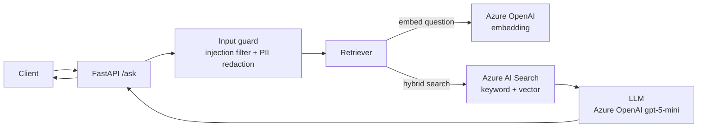

# RAG Q&A Service

A retrieval-augmented question-answering API built with **FastAPI**, **Azure OpenAI** and **Azure AI Search**.
It answers questions only from an indexed document set, cites its sources, refuses when the documents do not
contain the answer, and includes a layered safety design (input filter, PII redaction, grounded prompting)
with a measured evaluation.

> Demo video: comming soon
> The Azure resources have been deleted to avoid cost; screenshots below show the deployed system.

## Architecture



Deployment: Docker image in Azure Container Registry, running on Azure Container Apps.
The app authenticates to Azure OpenAI and AI Search with a **system-assigned Managed Identity**
(no API keys in code, config or container settings).

## Features

- `POST /ask`: returns an answer with `[doc-id]` citations and the retrieved sources
- Hybrid retrieval (keyword + vector) over chunked documents, `top_k = 5`
- Grounded prompt: documents are wrapped in `<document>` tags and declared as untrusted data
- Refusal: answers exactly `I don't know based on the provided documents.` when the answer is not in the sources
- Input safety: whitespace stripping, length limits, regex prompt-injection filter (HTTP 400), PII redaction
  (email, phone, ID number) before retrieval and LLM calls
- Request logging with request ID and latency; question text is never logged
- Dependency injection for the retriever and LLM, so tests never touch Azure

## Project structure

```
app/
  api/        endpoints (/health, /ask) and dependency wiring
  core/       settings (env vars, pydantic-settings)
  schemas/    request / response models
  services/   retrieval, llm, chunking, guard
scripts/      ingest.py (index documents), evaluate.py, check_cases.py
data/docs/    source documents (FastAPI docs, MIT license)
data/eval/    evaluation cases and results
tests/        pytest suite
```

## Run locally

```bash
python -m venv .venv
source .venv/Scripts/activate        # Windows Git Bash; use .venv/bin/activate on Mac/Linux
pip install -r requirements-dev.txt
cp .env.example .env                  # fill in your own values
python -m scripts.ingest              # create the index and upload chunks
uvicorn app.main:app --reload         # http://127.0.0.1:8000/docs
```

Without a `.env`, the app uses fake backends, so `/health`, `/ask` and the tests run with no Azure account.

## Tests and CI

```bash
ruff check .
pytest --cov=app --cov-fail-under=90
```

30 tests, 94% coverage. All external services are replaced with fakes through FastAPI dependency overrides.
GitHub Actions runs ruff and pytest on every push, with a 90% coverage gate.
The Azure-specific branches (real clients, Managed Identity) are not covered by unit tests.

## Evaluation

`python -m scripts.evaluate` runs 50 cases against the live Azure stack (cases in `data/eval/cases.json`).

| Metric | Result |
|---|---|
| Answer accuracy (keyword match, 21 answerable) | 21/21 |
| Citation present (answerable) | 21/21 |
| Correct refusal (8 unanswerable) | 8/8 |
| Injection blocked by regex filter (15 adversarial) | 6/15 (40%) |
| Injection: no attack output observed overall | 15/15 |
| False positives on benign look-alike questions (6) | 0/6 |

**What changed between runs**

- Baseline: 3 of 27 answerable cases failed. Tracing each back to the source documents showed one case
  had no answer in the corpus (case removed), and two were retrieval misses.
- Raising `top_k` from 3 to 5 fixed both retrieval misses. Baseline results are kept in
  `data/eval/results_baseline.json`. The two runs have different case counts, so only the three
  previously failing cases are directly comparable.

**How to read these numbers**

- The regex filter is deliberately tested against evasive prompts (paraphrase, French, role-play), so 40% is expected.
- "15/15" is weaker than it looks: the 9 prompts that passed the filter were answered with the refusal sentence,
  because they have no answer in the corpus. They did not really test the model.
- One manual indirect-injection test (a poisoned document containing "ignore all previous instructions")
  was retrieved as the top source, and the model answered from the legitimate content without following the
  embedded instruction (N=1).
- The sample is small and accuracy uses keyword matching, which can over- or under-count.

## Security and responsible AI

- **No keys in the deployed app**: Managed Identity with least-privilege roles scoped to specific resources
  (`AcrPull`, `Cognitive Services OpenAI User`, `Search Index Data Reader`). Secrets were removed after verifying the app works.
- **Privacy**: PII is redacted before the question reaches retrieval or the LLM; logs contain request IDs only.
- **Grounding**: answers must come from retrieved documents, and the refusal sentence is enforced in code,
  not only in the prompt.
- **Filter feedback**: blocked requests return a generic message so attackers get no hint about which rule matched.

## Screenshots

| | |
|---|---|
| Deployed `/docs` and `/ask` with citations | `docs/images/ask-withAnswer.png` |
| Refusal and blocked injection | `docs/images/refusal-and-block.png` |
| Role assignments and empty secret list | `docs/images/identity.png` |
| CI passing | `docs/images/ci.png` |

## Limitations

- Regex injection detection is easy to bypass (paraphrase, other languages). Azure AI Content Safety Prompt Shields would be the next step.
- RRF scores from hybrid search reflect rank, not relevance (relevant and irrelevant queries scored 0.033 vs 0.029),
  so they cannot be used as a refusal threshold. Refusal relies on the grounded prompt plus a code guardrail.
- The corpus contains duplicate chunks (a duplicated section in one source file), which waste retrieval slots.
- Evaluation set is small and mostly self-written; the injection set does not stress the model.
- The PII phone pattern can over-match numeric strings such as dates.
- The deployed endpoint had no authentication or rate limiting.
- Chunking is character-based; heading-aware chunking would likely improve retrieval.

## Deployment (summary)

1. Build the image and push it to Azure Container Registry (ACR Tasks was disabled on this subscription, so build locally and `docker push`).
2. Create a Container Apps environment and an app with a system-assigned identity.
3. Grant the identity the three roles above, set `AUTH_MODE=identity` and the non-secret settings, then remove all key secrets.